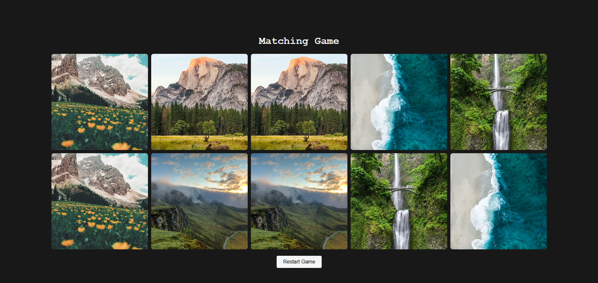

# Matching Card Game

An interactive memory-matching game built with HTML, CSS, and JavaScript. Players flip cards to find matching pairs, testing their memory while exploring a collection of nature-themed images.

The application uses vanilla JavaScript to manage card selections, compare matches, shuffle the board, and track game completion.

## Live Demo

**[Play Matching Card Game](https://anwaralshohatee.github.io/matching-card-games/)**

## Technologies


## Features

- Interactive memory game with 10 cards and 5 matching pairs
- Randomized card positions at the start of each game
- Click-to-flip card interactions
- Automatic comparison of two selected cards
- Keep matching pairs revealed
- Flip unmatched cards back after a short delay
- Prevent additional selections while checking a pair
- Display a completion message when all pairs are matched
- Restart the game with a newly shuffled board

## Screenshot



## How to Play

1. Click any card to reveal its image.
2. Select a second card to find a matching pair.
3. If the images match, both cards remain revealed.
4. If they do not match, both cards flip back after one second.
5. Continue until all five pairs are matched.
6. Click **Restart Game** to shuffle the cards and start again.

## Getting Started

### 1. Clone the Repository

```bash
git clone https://github.com/AnwarAlshohatee/matching-card-games.git
cd matching-card-games
```

### 2. Run the Application

Open `index.html` in your browser.

No additional dependencies, installations, or backend services are required.

## Project Structure

```text
matching-card-games/
├── assets/
│   ├── img1.jpg
│   ├── img2.jpg
│   ├── img3.jpg
│   ├── img4.jpg
│   └── img5.jpg
├── index.html
├── main.js
├── style.css
├── matching-game.PNG
└── README.md
```

## Future Improvements

- Add a timer to track completion speed
- Display the number of attempts and successful matches
- Add difficulty levels with different board sizes
- Save high scores using local storage
- Add card-flip animations and sound effects
- Improve keyboard accessibility

## Author

**Anwar Alshohatee**

[Portfolio](https://anwaralshohatee.netlify.app) | [LinkedIn](https://www.linkedin.com/in/anwaralshohatee/)
